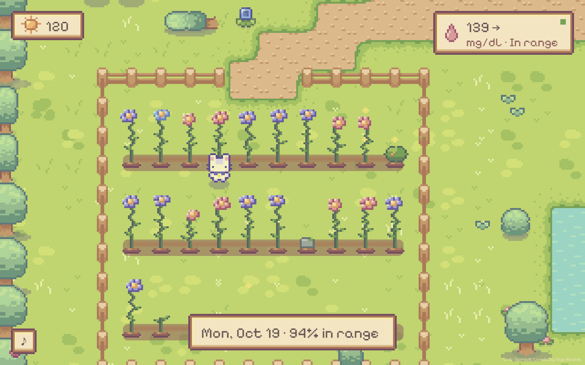
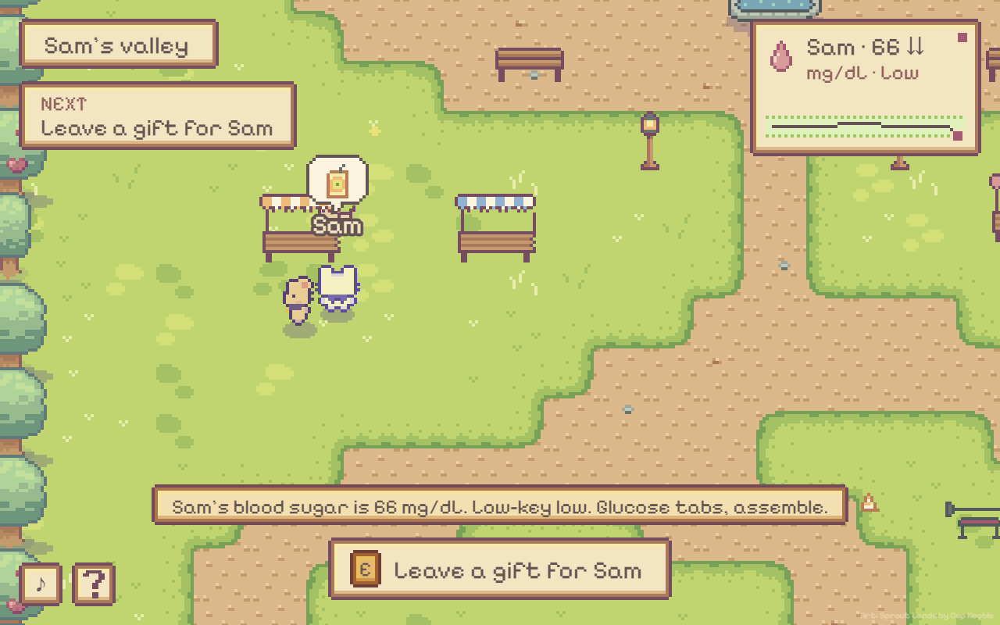

# Sugar Valley

A cozy village game for people with type 1 diabetes: every CGM reading in range brings sunlight back
to a faded valley, and friends and family can visit to cheer you on.

**[Play the live prototype](https://josephfanpm.github.io/sugarvalley/)** (real Dexcom readings, no
sign-in) · [Product requirements](docs/PRD.md) · [Build and run](docs/DEVELOPMENT.md)

Not a medical device. No alerts, no dosing advice. See the [safety rules](design/gdd/safety.md).

No sensor needed: on the live prototype, open /game/?demo to play offline with demo data.

| Garden of Days: one plant per day, grown from that day's glucose curve | A visitor in a friend's valley during a low |
|---|---|
|  |  |

<sub>Screenshots from QA runs with demo data ([production/qa/evidence/](production/qa/evidence/)). Some UI has changed since.</sub>

## Problem

Managing type 1 diabetes is constant, invisible work. A good day looks like nothing happened.
The tools that hold the data are clinical: numbers, graphs, alarms. Nothing there makes the effort
feel rewarding, and the people who care about you see either a raw number or nothing.

I live with type 1 diabetes, so I'm building the game I want to open each day.

<!-- TODO(Joseph): add how existing apps or games fall short, if you want that public. The repo
doesn't record a comparison. -->

## Target users

| User | Need |
|---|---|
| **Owner:** a person with T1D who wears a CGM, any age | A reason to look forward to the data; credit for good stretches without blame for bad ones |
| **Visitor:** a friend, parent or partner with the share link | A warm way to check in and help, without an account or a wall of numbers |

Kids play with parents; teens and adults play on their own. Text is short and every state also has
an icon ([game concept](design/gdd/game-concept.md)).

## Solution

A top-down pixel-art life sim, phone first, installable as a web app. It runs on real CGM data from
Dexcom, Libre or Nightscout. About 2–5 minutes of active play a day; the world advances from readings.

- **Sunlight:** each in-range reading earns 1. Spend it to restore 8 faded places (footbridge, coop,
  orchard…), each unlocking chores, crops or cooking.
- **Garden of Days:** each day's curve grows a unique plant. Rough days grow a hardy shrub, never a
  dead one.
- **Habit loops:** a weekly goal built from your weakest time of day, quick-comeback bonuses,
  steady-streak butterflies, a morning recap, and a tagging journal that shows what lines up with
  better days ([design](design/gdd/quests-journal.md)).
- **Living character:** stop moving and your character acts out your blood sugar: chores in range,
  a snack in town when low, the gym when high (33 actions).
- **Visitors:** a share link opens your valley. Visitors see your character, leave gifts, and get a
  "check on them" banner with Text/Call during urgent states.

## My role

Product owner and designer: concept, pillars, safety rules, reward economy, visitor privacy model and
scope ([game concept](design/gdd/game-concept.md), owner: Joseph). Built with Claude Code as the
engineering partner, using the Claude Code Game Studios framework at minimal rigor; commits are
co-authored with Claude.

<!-- TODO(Joseph): say in one line which parts you did hands-on (e.g. wrote the specs, tuned the
balance, playtested, drew any art) so readers don't have to infer it. -->

## Key decisions and trade-offs

| Decision | Options considered | Chosen | Given up | Why |
|---|---|---|---|---|
| **What earns rewards** | Reward every reading; reward logging; reward in-range only | +1 per in-range reading, 0 for lows. Comeback bonus capped so an excursion never beats staying in range | Simpler rewards; harder days earn less | Rewarding a low, even indirectly, could reward risk ([safety #4](design/gdd/safety.md), [sunlight.md](design/gdd/sunlight.md), [balance.js](src/data/balance.js)) |
| **What happens on bad days** | Streaks that reset, crops that wither (common retention levers); nothing decays | Nothing decays. Streaks pause. Rough days grow a shrub and get neutral copy ("a windy day") | Loss aversion as a motivator | "Motivation backfire" is the top design risk: pressure on hard days ([concept risks](design/gdd/game-concept.md#risks), [safety #6–9](design/gdd/safety.md)) |
| **Medical scope** | CGM companion with alerts; pure game | Not a medical device. Urgent states show a banner that can't be dismissed; data over 15 min old never reads as "fine" | Alerts and advice, the most obvious "useful" features | Keeps it a game with one hard rule: safety wins. The game keeps running under the banner (the character sits and treats) so it never feels like punishment ([safety #1–3](design/gdd/safety.md)) |
| **Sharing with family** | Visitor accounts; full data share; a link | No-account share link. Numbers on by default, owner can hide them; hidden mode sends only rounded daily values. Urgent contact number sent only during an urgent state. Visitors gift but can't spend | Visitor identity, richer social features | Easy for any age to join; the owner controls exposure ([visitors.md](design/gdd/visitors.md), [safety #11–13](design/gdd/safety.md)) |
| **Art and audio** | Original art; a premium pack; free packs | Free Sprout Lands Basic pack plus CC0 music and sounds; new art drawn only in its 97-color palette | Commercial release (Basic is non-commercial) and art breadth | Prototype speed at no cost; buy the Premium license if it ships commercially ([concept risks](design/gdd/game-concept.md#risks), [credits](#credits-and-licenses)) |
| **How to demo it** | Host the full server; static demo data; static site with real data | GitHub Pages build fed by a scheduled Action that publishes one owner's readings every 10 min | Multi-user, sign-in, 5-min freshness | A live link with real data and no server to run. The CGM login stays in repo secrets; only readings are published (commit `737c0a5`, [readings.yml](.github/workflows/readings.yml)) |

The project also pivoted from **Sugar Peek**, a Chrome extension that shared a live pixel-art peek at a
CGM reading ([extension/manifest.json](extension/manifest.json)), to this phone-first game (commit
`9e86812`).
<!-- TODO(Joseph): add the reason for the pivot from the Chrome extension to a game. Git history starts
at the overhaul, so the reasoning isn't recorded. -->

## Success metrics

**Measured so far**

- No user metrics yet. The game has no analytics, and the repo records no playtest results.
- 47 automated tests pass (`npm test`): CGM connectors, auth, sunlight and reward rules, safety rules
  (lows earn nothing, stale data), captions and insights.

<!-- TODO(Joseph): add any real playtest or usage results here (who played, for how long, what they
said). Don't add numbers that weren't measured. -->

**Design targets (from the specs, not measured)**

- 2–5 minutes of active play a day.
- All 8 restorations in about 9–12 days for someone around 70% time in range ([farm.md](design/gdd/farm.md)).

**KPIs I would track (proposed, not instrumented)**

| Goal | KPI | Note |
|---|---|---|
| Activation | % of new owners who connect a CGM and restore their first place on day 1 | First restore costs 150; a typical day earns ~200 |
| Habit | Days played per week per owner; D7 and D30 retention | The target is a short daily visit, not long sessions |
| Connection | % of owners with at least one visitor in week 1; gifts per owner per week | Tests the collaborative premise |
| Safety guardrail | Time below range does not rise after people start playing | Must hold before any other metric counts |
| Tone | Share of owners who say rough days feel neutral, not shaming (short survey) | Checks the "care, not score" pillar |
| Health signal (exploratory) | Change in time in range vs. each owner's own baseline | Self-selected and confounded; a signal, never a claim |

## Prioritization and roadmap

Sources: [systems index](design/gdd/systems-index.md), [safety rules](design/gdd/safety.md) and commit history.

| | Item | Why |
|---|---|---|
| **Now** | Forest hamlet and town playable with real data; GitHub Pages prototype live | Done: the systems index marks the core MVP systems built |
| **Next** | Sick-day pause (one tap pauses quests for up to 3 days) | Safety rule #8. Today a "Sick" journal tag lowers the weekly goal; there is no one-tap pause in code yet |
| **Next** | Playtests with owners and visitors, plus basic analytics for the KPIs above | No evidence yet that the loop works beyond the builder |
| **Next** | Hosted multi-user server (Docker and Fly.io ready, see [DEPLOY.md](DEPLOY.md)) with Google / Apple sign-in | Sign-in is built but needs client IDs and a domain |
| **Next** | Migrate rewards from Sugar Peek; remove legacy `extension/` and `web/` | Listed as MVP, not started |
| **Later** | Festivals (Lantern Night, Harvest Fair) | Post-MVP; a monthly reason to return |
| **Later** | Districts 2–5 (Beach cove, Town square, Snow village, Night market), outfits and decor | Post-MVP; needs more art, and the Premium art license for a commercial release |

Known risk: the Dexcom Share and LibreLinkUp connectors use unofficial endpoints that can change
without notice ([DEPLOY.md](DEPLOY.md)).

## Technical overview

```
CGM (Dexcom Share · LibreLinkUp · Nightscout · demo)
  → server/poller.js (every 5 min) → SQLite (node:sqlite), CGM credentials AES-256-GCM encrypted
  → server/valley.js: sunlight computed from stored readings, never trusted from the client
  → JSON API → Phaser 3 client (src/, PWA, no build step) for the owner or a visitor's share link
```

| Area | Choice |
|---|---|
| Client | Phaser 3.90 vendored (no CDN at runtime), plain ES modules, no build step, installable PWA with a service worker |
| Server | Node 22, **zero npm dependencies**: built-in `node:sqlite`, `node:test`, `node:crypto` |
| Shared rules | [valley-rules.js](src/data/valley-rules.js) and [balance.js](src/data/balance.js) run on the server (authoritative) and in the offline demo, so both follow one economy |
| Auth | Browser-held owner key, or Google / Apple ID tokens verified against provider keys ([server/auth.js](server/auth.js)); rate-limited visitor gifts |
| World | Maps built in code with autotiling, day/night lighting from the local clock, pathfinding and collisions ([src/world/](src/world/)) |
| Tests | 47 tests with `node --test` in [server/](server/) and [tests/unit/](tests/unit/) |
| CI/CD | GitHub Actions: [pages.yml](.github/workflows/pages.yml) deploys the static prototype; [readings.yml](.github/workflows/readings.yml) publishes readings |
| Deploy | Dockerfile and [fly.toml.example](fly.toml.example), see [DEPLOY.md](DEPLOY.md) |
| QA | Headless-Chrome screenshot script ([scripts/screenshot.mjs](scripts/screenshot.mjs)) with evidence in [production/qa/evidence/](production/qa/evidence/) |

Design docs: [game concept](design/gdd/game-concept.md), [safety](design/gdd/safety.md),
[sunlight economy](design/gdd/sunlight.md), [Garden of Days](design/gdd/garden-of-days.md),
[visitors](design/gdd/visitors.md), [farm](design/gdd/farm.md), [town](design/gdd/town.md),
[art bible](design/art-bible.md).

## Getting started

Requires Node 22.13 or newer. No npm dependencies.

```bash
npm start        # http://localhost:8787 → opens the game at /game/
npm test         # CGM connector, rewards and safety-rule tests
```

Open `/game/setup.html` and pick **Demo** as the CGM to try it without a sensor, or open
`/game/?demo` to play offline. Controls, test URLs, sign-in setup, CGM sources and project layout are
in [docs/DEVELOPMENT.md](docs/DEVELOPMENT.md). Hosting: [DEPLOY.md](DEPLOY.md).

`.claude/`, the `CLAUDE.md` files, `project.yaml` and most of `docs/` come from the
[Claude Code Game Studios](https://github.com/donchitos/claude-code-game-studios) framework. They are
tooling, not product docs.

## Limitations

- No user metrics yet. The game has no analytics and the repo records no playtest results, so nothing here proves the loop works beyond the builder. The 2 to 5 minutes of active play a day, and all 8 restorations in about 9 to 12 days for someone around 70% time in range, are design targets from the specs, not measured results.
- The MVP (forest hamlet and town) is built, but it has not been playtested with outside users. The live prototype runs on one owner's real Dexcom readings, with no sign-in.
- Multi-user hosting is not live. Sign-in is built but needs client IDs and a domain, and the Docker and Fly.io setup is ready in the repo but not deployed.
- The sick-day pause is specified in the safety rules but not built in code. Today a Sick journal tag lowers the weekly goal, and there is no one-tap pause yet.
- Districts 2 to 5, festivals, outfits and decor are post-MVP and not built. The Sugar Peek rewards migration, and removing the legacy extension and web folders, are listed as MVP work and not started.
- The Dexcom Share and LibreLinkUp connectors use unofficial endpoints that can change without notice.
- Screenshots on this page are from QA runs with demo data, and some UI has changed since.
- Art uses the free Sprout Lands Basic pack, licensed for non-commercial use only. A commercial release needs the Premium license.
- What I would do next: playtests with owners and visitors, plus basic analytics for the KPIs in this README, then the hosted multi-user server, then the sick-day pause.

## Credits and licenses

- **Art:** Assets - From: [Sprout Lands](https://cupnooble.itch.io/sprout-lands-asset-pack) - By: Cup Nooble.
  See [assets/art/LICENSE-SproutLands.txt](assets/art/LICENSE-SproutLands.txt). The
  free Basic pack is licensed for **non-commercial use only**, with credit. A commercial release
  needs the Premium license. The raw pack is gitignored and must not be redistributed.
- **Audio:** CC0 music by MintoDog and sounds by Kenney, see [assets/audio/CREDITS.md](assets/audio/CREDITS.md).
- **Font:** DotGothic16 (SIL Open Font License, [src/fonts/OFL-DotGothic16.txt](src/fonts/OFL-DotGothic16.txt)).
- **Engine:** [Phaser](https://phaser.io) (MIT).
- New pixel art (Sun Well, lanterns, icons, UI panel, plants, town and building interiors) is original
  to this project and uses only the Sprout Lands palette.

<!-- TODO(Joseph): the repo has no license file for the project's own code. Add one if you want others
to reuse it. -->
